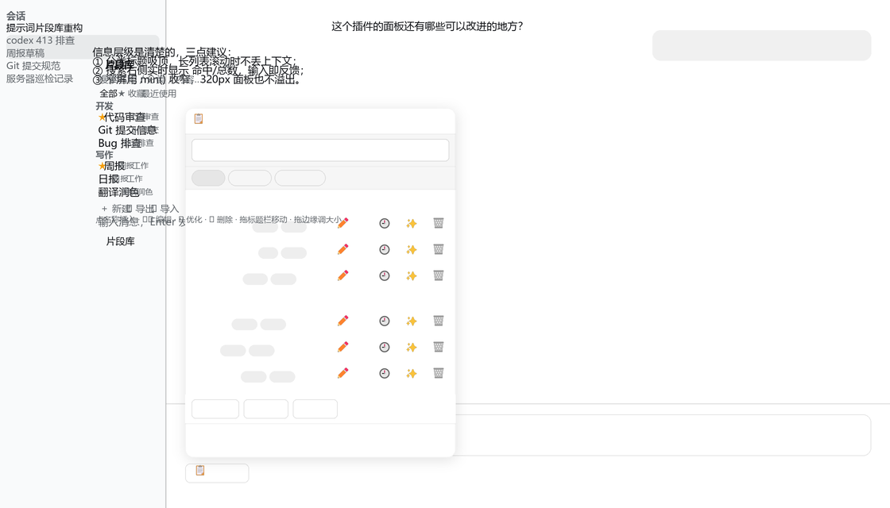
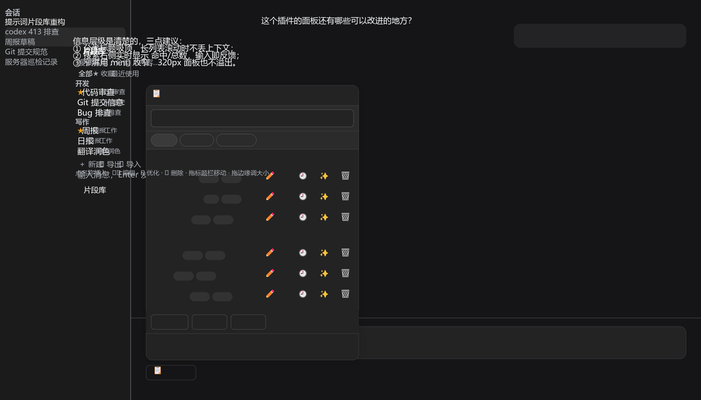
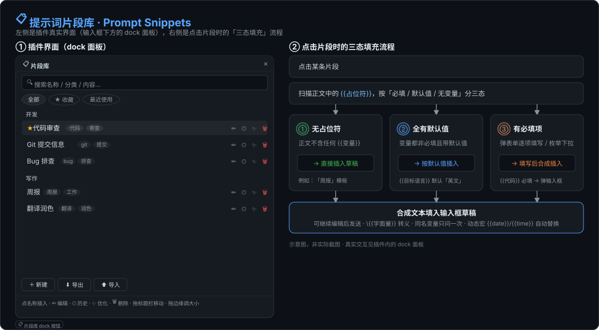

# 提示词片段库 Prompt Snippets

[](https://github.com/dadazhangn/dsh-prompt-snippets/actions/workflows/ci.yml)
[](https://www.npmjs.com/package/dsh-prompt-snippets)
[](LICENSE)
[](test/)

> **常用提示词，别再手打第二遍。** 存下来，点一下就进输入框。

一个 DSH 插件：把反复要写的提示词（代码审查、周报、翻译润色……）存成片段，
在输入框下方的「📋 片段库」里按分类浏览、搜索、一键插入；正文里的 `{{占位符}}`
会在插入时弹表单让你填。

<p align="center">
  
</p>

## 为什么用它

| | 手动复制粘贴 | 系统提示词 / 自定义指令 | **本插件** |
|---|---|---|---|
| 数量 | 几十条就找不着了 | 只能全局常驻几条 | 不限，按分类分组 |
| 切换成本 | 翻聊天记录 | 改配置再重启 | 点一下，或者 `Ctrl+Shift+K` |
| 参数化 | ✗ | ✗ | `{{占位符}}` 表单，`{{date}}` 等宏变量 |
| 用完就走 | 数据散在剪贴板 | 一直占 token | 只在插入那一刻进草稿 |
| 数据在哪 | — | 配置文件 | 本机 JSON，可导入导出、有版本历史 |

配合下面这些细节，它不只是「一个存文本的地方」：插入前能改占位符、插入后能撤销删除、
AI 优化时先给你双栏对比再决定要不要落盘。

## 安装

```bash
dsh plugin --profile web add dsh-prompt-snippets
```

`web` 换成你实际使用的 profile 名（本机 profile 在 `~/.dsh/profiles/<名字>`）。
装完重启 DSH、刷新页面，输入框下方就会出现「📋 片段库」。

从 GitHub 装（版本跟随仓库 HEAD，不等 npm 发布）：

```bash
dsh plugin --profile web add github:dadazhangn/dsh-prompt-snippets
```

本地源码调试用路径安装：

```bash
dsh plugin --profile web add link:C:/path/to/dsh-prompt-snippets
```

要求 DSH `>=0.2.1-rc.3`（`package.json` 的 `engines.dsh`）。市场在安装前会按这条
检查宿主版本，不满足时禁用「安装」按钮并说明原因。

<details>
<summary>Install (English)</summary>

```bash
dsh plugin --profile web add dsh-prompt-snippets
```

Or install straight from GitHub (`github:dadazhangn/dsh-prompt-snippets`), which
tracks the repository HEAD instead of the published npm version. Then restart DSH
and reload the page. Requires DSH `>=0.2.1-rc.3`.

</details>

## 三十秒上手

```
/snippet add 代码审查  请审查以下代码并指出问题：{{代码}} --cat=开发
/snippet add 周报  总结本周工作：{{要点}} --cat=写作
```

然后在任意会话里点「📋 片段库」→ 点片段名，内容就进草稿了。改内容也不用敲命令：
面板里点 ✏️ 直接编辑，改完点「保存」。

想随时唤起而不先开面板：`Ctrl+Shift+K`（或 `Ctrl+Shift+P`）弹出搜索浮层，
输入关键字即时过滤，`↑` `↓` 选择、`Enter` 插入、`Ctrl+Enter` 插入并立即发送。

<p align="center">
  
</p>

## 主要功能

### 组织与检索

- **分类**：`--cat=<分类>`（或 `-c=`）指定，面板按分类分组展示、分类标题吸顶。
  **参数只认行尾**——正文中间的 `--cat` 按字面保留；想在正文结尾真写 `--cat`，用 `--` 收尾：
  `/snippet add 说明 结尾是 -- --cat`。更新内容不带 `--cat` 时保留原分类，不会被清空。
- **标签**：`/snippet tag <名称> <标签1、标签2…>`，逗号 / 顿号 / 空格分隔，最多 32 个、
  每个最长 24 字；`add` / `save` 也能用 `--tag=`。面板里以圆角 chip 显示在名称后。
- **收藏置顶**：`/snippet pin <名称>` / `unpin`（`add` 也可 `--pin`）。面板顶部三个视图：
  「全部 / ★ 收藏 / 最近使用」（最近使用按 `lastUsedAt` 降序，最多 20 条）。
- **搜索**：按名称、分类、标签、正文实时筛选，打开面板自动聚焦；命中词在名称里高亮，
  右侧显示 `当前/总数` 命中计数；键盘 `↑` `↓` 移动、`Enter` 插入、`Esc` 逐层退出。
  无命中时给一个「＋ 新建『搜索词』」按钮，点一下把搜索词预填成新片段名。
- **命令面板**：`Ctrl+Shift+K` / `Ctrl+Shift+P` 全局唤起，收藏自动置顶，列表自动滚动跟随选中项。

### 插入与占位符

- **一键插入**：点片段名即插入当前草稿。插入失败（草稿在面板打开期间被改动、或输入框正在提交）
  会在面板内说明原因，不会静默失败。
- **`{{占位符}}` 智能填充**，按情况分三档：
  - 无占位符 → 直接插入；
  - 全部非必填且都有默认值 → 按默认值插入，并提示「可在 ✏️ 里改」；
  - 有必填项（或旧数据缺变量元数据）→ 弹表单逐项填写，必填为空时「插入」禁用，
    也可选「保留占位符插入」原样插入。

  `\{{字面量}}` 转义后插入的是字面量；同名占位符只问一次，全实例填同一个值。
- **动态变量**：`{{date}}` / `{{time}}` / `{{datetime}}` 是内置宏，插入时用本地时间实时替换
  （`YYYY-MM-DD` / `HH:mm` / `YYYY-MM-DD HH:mm:ss`），不弹表单、不进变量元数据；
  只有动态变量的片段点一下即直插。

<p align="center">
  
</p>

### 面板内编辑

- **编辑 / 新建都在面板里完成**：点 ✏️ 在原行下方展开编辑器，改名称、分类、正文，
  并直接维护变量（必填勾选 + 默认值）；底部「＋ 新建」同样不需要敲命令。
- **乐观锁**：两个标签同时改同一条，后保存者看到冲突横幅，可选「覆盖」或「重新载入」。
  草稿没保存时点面板外部不会关闭面板，取消也要二次确认。
- **删除可撤销**：点 🗑 后底部出现撤销条，记住最近 5 条，可逐条恢复或一键全部撤销。
- **版本历史**：每次保存前的旧内容自动留档（每片段最多 20 版，单片段历史体积超限丢最旧）。
  点 🕘 展开历史回看历次正文；`/snippet show` 也会显示 revision 号。
- **可拖动 / 可缩放 / 记忆位置**：拖标题栏移动；四条边和四个角都能拖（像 Windows 窗口），
  最小 200×160。位置与尺寸记在浏览器本地，下次打开沿用；缩到超出视口会自动收窄拉回。
- **窄屏可用**：宽度取 `min(340px, 100vw - 16px)`，窗口缩到 320px 也不溢出，
  视口变化后自动拉回可视区。
- **深浅色跟随**：面板全部使用 DSH 主题 token，无白底刺眼。

### AI 优化：先对比，再决定

点 ✨ 用当前默认模型改写片段，结果进「原文 / 优化后」双栏对比，**不直接插入、也不自动落盘**。
优化后那一栏可直接编辑，微调后再决定怎么用。对比视图给出字节数变化与占位符保全标记
（丢了哪个 `{{x}}` 会点名，字节数随编辑实时重算）。

| 按钮 | 行为 |
|---|---|
| 插入优化版 | 只进输入框，不动库里的片段；插入的是你编辑后的文本 |
| 替换片段正文 | **唯一会落盘**的动作，带 `expectedRevision` 乐观锁；冲突时只提供「用优化版覆盖（force）」与「放弃」，不做自动合并 |
| 再试 | 最多 3 次，之后置灰 |
| 保留原文插入 | 走原始正文 |
| ✕ | 走 `AbortController` 取消；host 回 `aborted` 时静默收起 |

优化结果超长或丢了占位符时，「替换片段正文」禁用并在 `title` 写明原因，把超长部分删短后自动解除。
当前未配置默认模型时 ✨ 直接置灰，`title` 说明原因，不会等到点击才报错。

### 导入导出与冷启动

- **导入 / 导出**：`/snippet export [文件名]` 导出全部片段为 JSON，落在
  `<DSH_HOME>/data/prompt-snippets/exports/`；`/snippet import <路径>` 导回来，
  `--replace` 用文件内容替换现有库（未出现的片段软删除，仍可 `undo`），`--dry` 只预演不写入。
  面板底部也有「⬇ 导出」「⬆ 导入」两个按钮（面板拿不到宿主文件系统，路径由 host 侧读取；
  省略目录与 `.json` 后缀时回落到 `exports/`）。
- **内置模板包**：首次运行（数据文件尚不存在）自动预置一组高频片段——代码审查、Git 提交信息、
  Bug 排查、周报、日报、翻译润色、会议纪要、学习计划。删掉后不重灌；已有数据文件
  （哪怕清空成 0 条）也不会再注入。

## 命令一览

| 命令 | 说明 |
|---|---|
| `/snippet add <名称> <内容> [--cat=] [--tag=] [--pin]` | 保存片段，同名即更新 |
| `/snippet list` | 列出全部片段 |
| `/snippet show <名称>` | 查看正文与 revision 号 |
| `/snippet rm <名称>` | 软删除（可 undo） |
| `/snippet undo <名称>` | 恢复已删除的片段 |
| `/snippet mv <旧名> <新名>` | 改名 |
| `/snippet tag <名称> <标签…>` | 打标签 |
| `/snippet pin` / `unpin <名称>` | 收藏 / 取消收藏 |
| `/snippet optimize <名称>` | 用当前默认模型优化 |
| `/snippet export [文件名]` | 导出 JSON |
| `/snippet import <路径> [--replace] [--dry]` | 导入 JSON |

重名时不会瞎删，会列出候选让你用 `#id前缀` 精确指定。

## 数据

文件：`<DSH_HOME>/data/prompt-snippets/snippets.json`（`DSH_HOME` 未设置时为 `~/.dsh`）。
**默认只存本机、不上传任何内容**；仅当你主动点 ✨ AI 优化时，才把当前那一条片段文本
发送给你配置的模型服务，除此之外不与网络通信。

结构（`version: 4`）：

```json
{
  "version": 4,
  "snippets": [
    {
      "id": "uuid",
      "name": "名称",
      "category": "分类或 null",
      "content": "正文",
      "variables": { "变量名": { "label": "…", "default": "…", "options": ["…"], "required": false } },
      "tags": ["标签"],
      "pinned": false,
      "pinnedAt": null,
      "createdAt": 0,
      "updatedAt": 0,
      "deletedAt": null,
      "revision": 1,
      "useCount": 0,
      "lastUsedAt": null
    }
  ]
}
```

写入可靠性：

- **原子**：先写同目录临时文件 → `fsync` → 轮换 `.bak` → `rename` 覆盖。进程中断不会留下半个
  JSON，最坏情况是文件停在上一份完整内容。
- **串行**：并发保存 / 删除排队执行，不会互相覆盖。
- **备份轮换**：`.bak` 写新值前先逐级后移成 `.bak.1` / `.bak.2` …最多保留 7 份，
  `.bak` 始终是最新一份。
- **损坏自愈**：文件不是合法 JSON 或结构不可识别时，备份成
  `snippets.corrupt-<时间戳>.json`（最多 5 份），插件以空库继续运行并在面板顶部提示；
  第二次读取不重复备份。
- **旧版本迁移**：`version: 1/2/3` 首次读取时补齐 `id` / `revision` / `variables` / `useCount` /
  `tags` / `pinned` 等字段升级到 `version: 4`；迁移前把**原始字节**存成
  `snippets.json.pre-v4.bak`（一次性，已存在则保留更早那份）。迁移幂等，第二次读取不再写盘。
- **保守处理异常数据**：无法识别的条目丢弃并给出 `warning` 计数；重复 `id` 修复；
  `revision` 非法值归一到 1。
- **不认识的更新版本只读**：文件 `version` 大于插件支持的版本时只读跳过加载，原文件一字不改。
- **软删除**：`deletedAt` 非空即视为已删除，记录仍留在文件里，所以 `undo` 能立刻恢复。

## 结构

host 半（`index.js`：命令 + RPC + JSON 存储）、client 半（`client.js`：输入框 dock 面板 UI）。

```
index.js            host 半：/snippet 命令 + /prompt-snippets RPC + JSON 持久化
client.js           client 半：conversation.composer.dock 面板
package.json        bundle 声明（dsh.bundle.patch + dsh.client + engines.dsh）
cordis.patch.yml    插入 host 半的 loader patch
locale/{en,zh}.json 市场显示名与描述
icon.svg            图标
LICENSE             MIT
test/               测试套件（随仓库分发，不进 npm 包）
.github/workflows   GitHub Actions 自动验证
```

## 测试

`test/` 里有一组自测脚本，当前覆盖 **466 条断言**：

| 套件 | 覆盖 |
|---|---|
| `v110-host-test.mjs` | 迁移矩阵与迁移前备份、存储可靠性、双轨匹配、占位符扫描、`--cat` 收口、能力握手、只读保护、标签/收藏/版本历史、首次预置模板包（177） |
| `optimize-test.mjs` | 优化流的分支与降级（14） |
| `io-test.mjs` | 导入/导出命令：落盘、文件名安全、后缀回退、merge/replace/dry、往返一致、同名去重、大小限制、一键打开（78） |
| `client-test.mjs` | 渲染、搜索高亮、命中计数、键盘导航、插入、占位符表单、行内编辑、冲突处理、多条撤销、优化三态对比（含优化后编辑）、导入导出按钮、使用统计 touch、主题 token、窄屏、窗口缩放、标签/收藏/视图切换/版本历史、命令面板、动态变量（191） |
| `client-error-test.mjs` | 插入失败的报错链路（6） |

测试通过 `isolate-home.mjs` 把 `DSH_HOME` 顶到系统临时目录，**绝不读写真实片段库**。

每次 push、发 tag（`v*`）、提 PR 时 GitHub Actions 会自动跑「语法检查 + 这 5 个套件」
（见 `.github/workflows/ci.yml`），任何一步失败都会在 PR 上打红叉阻止合并。

```bash
npm test
```

## 反馈

遇到问题或有想法，欢迎[开 issue](https://github.com/dadazhangn/dsh-prompt-snippets/issues)。
说明 DSH 版本、插件版本和复现步骤，会快很多。

## License

[MIT](LICENSE)
